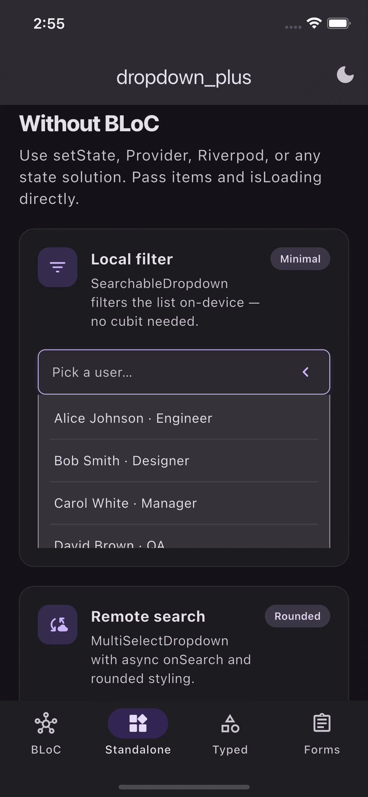
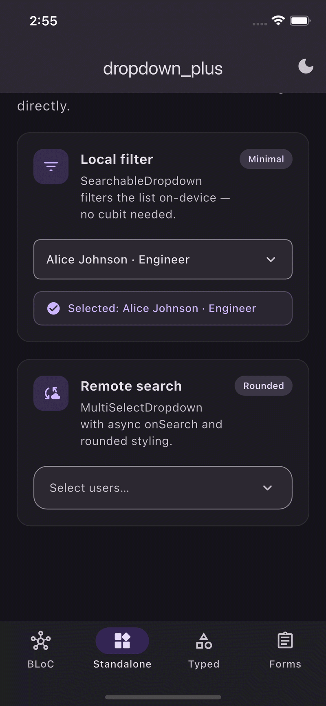
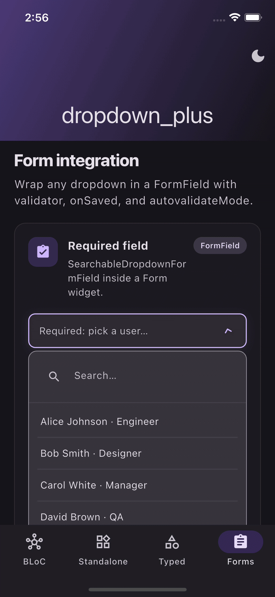

# dropdown_plus_bloc

[](https://pub.dev/packages/dropdown_plus_bloc)
[](https://opensource.org/licenses/MIT)

Searchable single-select and multi-select Flutter dropdowns with optional **BLoC/Cubit** integration, theming, form fields, pagination, cascade menus, and an opt-in typed API.

| Widget | Description |
|--------|-------------|
| `SearchableDropdownPlus` | Single-select with BLoC/Cubit |
| `MultiSelectDropdownPlus` | Multi-select with chips + BLoC/Cubit |
| `SearchableDropdown` | Single-select without BLoC (`items` / `isLoading`) |
| `MultiSelectDropdown` | Multi-select without BLoC |
| `CascadeDropdown` | Nested / cascade single-select (web fly-out or mobile drill-down) |
| `*FormField` | `Form` wrappers with `validator` / `onSaved` |
| `Typed*` (opt-in) | Work with `User` (or any `T`) instead of `DropdownItem` |

```dart
import 'package:dropdown_plus_bloc/dropdown_plus_bloc.dart'; // default API
import 'package:dropdown_plus_bloc/typed.dart';             // typed API + controllers
```

---

## Features

- BLoC/Cubit or plain `items` / `isLoading` APIs
- Typed generics (`Typed*`) — no manual `DropdownItem` mapping
- Programmatic control — `DropdownPlusController` / `DropdownPlusMultiController`
- Form fields with validation
- Search with optional debounce and offline cache fallback
- Pagination via `onLoadMore` / `hasMore` / `isLoadingMore`
- **Overlay menu** — floats over content (does not push the UI down)
- **CascadeDropdown** — nested menus (`view`: auto / web / mobile; lazy API children)
- Smooth open / close animation; inset selection & hover highlights
- Theming presets + full `DropdownPlusTheme` overrides
- Custom builders, controlled selection, accessibility (`Semantics`, `focusNode`)

---

## What's new in 1.6.0

- **`CascadeDropdown`** — hierarchical picker with `CascadeMenuItem` trees and optional `leading` icons.
- **`view: CascadeView.auto | .web | .mobile`** — fly-out on desktop/web, drill-down on phones (or force either).
- **Lazy submenus** — `hasChildren` + `onLoadChildren` (+ loading / error builders) for API-backed trees.
- Path highlighting for open / selected ancestors; optional `showPathInTrigger`.
- Example **Cascade** tab with style toggle and lazy-load demo.

See [CHANGELOG.md](CHANGELOG.md) for the full history.

---

## Screenshots

<p>
  
  &nbsp;
  
</p>

<p>
  
</p>

---

## Installation

```yaml
dependencies:
  dropdown_plus_bloc: ^1.6.0
```

```bash
flutter pub get
```

`flutter_bloc` is a transitive dependency (needed for `*Plus` widgets).

---

## Quick start (BLoC)

```dart
SearchableDropdownPlus<UsersCubit, UsersState>(
  cubit: context.read<UsersCubit>(),
  hintText: 'Select user…',
  onSearch: (query) => context.read<UsersCubit>().search(query),
  onStateChange: (state, updateList, updateLoading) {
    if (state is UsersLoaded) {
      updateList(
        state.users
            .map((u) => DropdownItem(value: u, label: u.name))
            .toList(),
      );
      updateLoading(false);
    } else if (state is UsersLoading) {
      updateLoading(true);
    }
  },
  onSelectionChanged: (item) {
    final user = item.value as User;
  },
)
```

### Multi-select

```dart
MultiSelectDropdownPlus<UsersCubit, UsersState>(
  cubit: context.read<UsersCubit>(),
  hintText: 'Select users…',
  onSearch: (query) => context.read<UsersCubit>().search(query),
  onStateChange: (state, updateList, updateLoading) {
    if (state is UsersLoaded) {
      updateList(
        state.users
            .map((u) => DropdownItem(value: u, label: u.name))
            .toList(),
      );
      updateLoading(false);
    }
  },
  onSelectionChanged: (items) {
    final users = items.map((e) => e.value as User).toList();
  },
)
```

---

## Without BLoC

Pass `items` and `isLoading` from your own state. Omit `onSearch` for local filtering over `items`, or provide `onSearch` and rebuild with new results.

```dart
SearchableDropdown(
  hintText: 'Select user…',
  items: userItems,
  isLoading: isLoading,
  selectedValue: selectedUserItem,
  onSearch: (query) async {
    setState(() => isLoading = true);
    final list = await api.searchUsers(query);
    setState(() {
      userItems =
          list.map((u) => DropdownItem(value: u, label: u.name)).toList();
      isLoading = false;
    });
  },
  onSelectionChanged: (item) =>
      setState(() => selectedUserItem = item),
)
```

```dart
MultiSelectDropdown(
  hintText: 'Select users…',
  items: userItems,
  isLoading: isLoading,
  selectedItems: selectedUserItems,
  onSelectionChanged: (items) =>
      setState(() => selectedUserItems = items),
)
```

---

## Cascade / nested menu

Standalone hierarchical picker — **no search, multi-select, or BLoC**. Leaves call `onChanged`.

| `view` | Behavior |
|--------|----------|
| `CascadeView.auto` (default) | Fly-out when wide; drill-down when `width < flyoutBreakpoint` (default `600`) |
| `CascadeView.web` | Side fly-out submenus (hover or tap) |
| `CascadeView.mobile` | One panel with **Back** header |

Also: path highlighting for open / selected ancestors; `showPathInTrigger` for `Parent › Child › Leaf`.

```dart
CascadeDropdown<String>(
  hintText: 'Pick a region…',
  value: selectedCode,
  showPathInTrigger: true, // Europe › France
  view: CascadeView.auto, // or .web / .mobile
  items: const [
    CascadeMenuItem(
      label: 'Europe',
      leading: Icon(Icons.public),
      children: [
        CascadeMenuItem(label: 'France', value: 'fr'),
        CascadeMenuItem(label: 'Germany', value: 'de'),
      ],
    ),
    CascadeMenuItem(
      label: 'Asia',
      children: [
        CascadeMenuItem(label: 'Japan', value: 'jp'),
      ],
    ),
  ],
  onChanged: (code) => setState(() => selectedCode = code),
)
```

### Lazy / API-loaded submenus

Mark a branch with `hasChildren: true` and empty `children`, then supply `onLoadChildren`.
Load the **root** list in your Cubit / `setState` and pass it as `items`.

```dart
CascadeDropdown<String>(
  hintText: 'Pick a region…',
  items: const [
    CascadeMenuItem(label: 'Europe', value: 'eu', hasChildren: true),
    CascadeMenuItem(label: 'Asia', value: 'as', hasChildren: true),
  ],
  onLoadChildren: (parent) async {
    final rows = await api.fetchChildren(parent.value!);
    return rows
        .map(
          (e) => CascadeMenuItem(
            label: e.name,
            value: e.id,
            hasChildren: e.hasKids,
          ),
        )
        .toList();
  },
  // childrenLoadingBuilder: (context, parent) => ...,
  // childrenErrorBuilder: (context, parent, error, retry) => ...,
  onChanged: (id) => setState(() => selectedCode = id),
)
```

---

## Typed API

Opt-in import — use your domain type `T` directly:

```dart
import 'package:dropdown_plus_bloc/typed.dart';

TypedSearchableDropdownPlus<User, UsersCubit, UsersState>(
  cubit: context.read<UsersCubit>(),
  hintText: 'Select user…',
  itemLabel: (user) => user.name,
  itemEquals: (a, b) => a.id == b.id,
  value: selectedUser,
  onChanged: (user) => setState(() => selectedUser = user),
  onSearch: (query) => context.read<UsersCubit>().search(query),
  onStateChange: (state, updateItems, updateLoading) {
    if (state is UsersLoaded) {
      updateItems(state.users); // List<User>
      updateLoading(false);
    } else if (state is UsersLoading) {
      updateLoading(true);
    }
  },
)
```

```dart
TypedSearchableDropdown<User>(
  hintText: 'Select user…',
  items: users,
  isLoading: isLoading,
  itemLabel: (u) => u.name,
  value: selectedUser,
  onChanged: (user) => setState(() => selectedUser = user),
)
```

| Default export | Typed export |
|----------------|--------------|
| `SearchableDropdownPlus<C, S>` | `TypedSearchableDropdownPlus<T, C, S>` |
| `MultiSelectDropdownPlus<C, S>` | `TypedMultiSelectDropdownPlus<T, C, S>` |
| `SearchableDropdown` | `TypedSearchableDropdown<T>` |
| `MultiSelectDropdown` | `TypedMultiSelectDropdown<T>` |

Bridge helper for gradual migration:

```dart
final items = users.toDropdownItems((u) => u.name);
```

More detail: [doc/TYPED_API.md](doc/TYPED_API.md)

---

## Controller

Programmatic select / clear / open / close (typed widgets):

```dart
final controller = DropdownPlusController<User>();

TypedSearchableDropdown<User>(
  controller: controller,
  hintText: 'Select user…',
  items: users,
  isLoading: false,
  itemLabel: (u) => u.name,
  onChanged: (user) => setState(() => selectedUser = user),
);

controller.select(user); // also calls onChanged
controller.clear();
controller.open();
controller.close();
```

Multi-select: `DropdownPlusMultiController<T>` with `select`, `deselect`, `setValues`, and `clear`.

When a controller is passed, it owns selection. Widget `value` / `values` are only used as an initial seed.

---

## Form fields

```dart
Form(
  key: _formKey,
  child: SearchableDropdownFormField(
    hintText: 'Select user…',
    items: userItems,
    isLoading: false,
    validator: (value) => value == null ? 'Required' : null,
    onSaved: (item) => _savedUser = item?.value as User?,
  ),
)
```

| Widget | Wraps |
|--------|-------|
| `SearchableDropdownFormField` | `SearchableDropdown` |
| `SearchableDropdownPlusFormField<C, S>` | `SearchableDropdownPlus` |
| `MultiSelectDropdownFormField` | `MultiSelectDropdown` |
| `MultiSelectDropdownPlusFormField<C, S>` | `MultiSelectDropdownPlus` |

Shared params: `validator`, `onSaved`, `autovalidateMode`, `initialValue` / `initialValues`, `enabled`.

---

## Pagination

```dart
SearchableDropdownPlus<UsersCubit, UsersState>(
  cubit: cubit,
  hintText: 'Select user…',
  hasMore: state.hasMore,
  isLoadingMore: state.isLoadingMore,
  onLoadMore: cubit.fetchNextPage,
  onSearch: cubit.search,
  onStateChange: (state, updateList, updateLoading) { /* ... */ },
)
```

Available on all four dropdown widgets and their typed counterparts.

---

## Theming

### Presets

```dart
SearchableDropdownPlus(
  themeStyle: DropdownPlusThemeStyle.compact,
  // ...
)
```

| Style | Look |
|-------|------|
| `material` | Default Material-like |
| `minimal` | Light borders, subtle surfaces |
| `rounded` | Larger radius, soft panel |
| `outlined` | Strong border focus |
| `dark` | Dark surfaces |
| `compact` | Dense spacing |

`dropdownTheme` overrides `themeStyle` when both are set.

### Custom theme

```dart
dropdownTheme: DropdownPlusTheme(
  backgroundColor: Colors.grey[100],
  borderColor: Colors.grey[300],
  activeBorderColor: Colors.deepPurple,
  borderRadius: 12,
  menuMaxHeight: 280,
  selectedItemBackgroundColor: Colors.deepPurple.withValues(alpha: 0.08),
)
```

Override a preset selectively:

```dart
themeStyle: DropdownPlusThemeStyle.dark,
dropdownTheme: DropdownPlusThemePresets
    .forStyle(DropdownPlusThemeStyle.dark)
    .copyWith(borderRadius: 16),
```

See the [`DropdownPlusTheme`](#dropdownplustheme-reference) table below for all properties.

---

## Controlled mode

Sync selection from outside (form reset, QR scan, etc.):

```dart
SearchableDropdownPlus(
  key: ValueKey(qrKey), // bump key to force re-sync if needed
  selectedValue: scannedItem,
  // ...
)
```

Or use a [controller](#controller) with the typed API.

---

## Custom builders

```dart
itemBuilder: (item, isSelected) {
  final user = item.value as User;
  return ListTile(
    leading: CircleAvatar(child: Text(user.name[0])),
    title: Text(user.name),
    trailing: isSelected ? const Icon(Icons.check) : null,
  );
},
```

```dart
selectedItemBuilder: (selected) => Text(
  selected.map((e) => e.label).join(' • '),
  overflow: TextOverflow.ellipsis,
),
```

Also supported: `emptyBuilder`, `loadingBuilder`, `errorBuilder`, and (typed) `valueBuilder` / `valuesBuilder`.

---

## Offline caching

```dart
checkInternetConnection: () async {
  final result = await Connectivity().checkConnectivity();
  return result != ConnectivityResult.none;
},
```

When offline, the widget filters the cached list locally instead of calling `onSearch`.

---

## Common parameters

These apply across the main dropdown widgets (names vary slightly for multi / typed):

| Parameter | Description |
|-----------|-------------|
| `hintText` | Trigger placeholder |
| `enabled` | Disable open/search when `false` |
| `debounceDuration` | Delay before `onSearch` (default: none) |
| `minSearchLength` | Skip `onSearch` until query length ≥ N |
| `autofocusSearch` | Focus search field when panel opens |
| `searchHint` / `noResultsText` / `loadingText` | Panel copy |
| `emptyBuilder` / `loadingBuilder` / `errorBuilder` | Custom panel states |
| `error` / `onRetry` | Controlled error display |
| `onLoadMore` / `hasMore` / `isLoadingMore` | Pagination |
| `semanticsLabel` / `focusNode` | Accessibility |
| `dropdownTheme` / `themeStyle` | Appearance |
| `checkInternetConnection` | Offline fallback |

---

## API reference

### `SearchableDropdownPlus<C, S>`

| Parameter | Required | Description |
|-----------|----------|-------------|
| `cubit` | ✅ | BLoC/Cubit instance |
| `onSearch` | ✅ | Called on search changes |
| `onStateChange` | ✅ | Maps state → `updateList` / `updateLoading` |
| `hintText` | ✅ | Placeholder |
| `selectedValue` | — | Controlled selection |
| `onSelectionChanged` | — | User pick callback |
| `needInitialFetch` | — | Call `onSearch('')` on mount |
| `itemBuilder` / `selectedValueBuilder` | — | Custom UI |
| (+ [common parameters](#common-parameters)) | | |

### `MultiSelectDropdownPlus<C, S>`

Same as single-select Plus, plus:

| Parameter | Default | Description |
|-----------|---------|-------------|
| `selectedItems` | `[]` | Controlled selection |
| `onSelectionChanged` | — | `(List<DropdownItem>)` |
| `maxDisplayChips` | `2` | Chips before `+N more` |
| `selectedItemBuilder` | — | Custom chip row |
| `buttonHeight` / `buttonWidth` | — | Fixed trigger size |

### `SearchableDropdown` / `MultiSelectDropdown`

| Parameter | Required | Description |
|-----------|----------|-------------|
| `hintText` | ✅ | Placeholder |
| `items` | ✅ | Current list |
| `isLoading` | ✅ | Loading UI |
| `onSearch` | — | Remote search; omit for local filter |
| `selectedValue` / `selectedItems` | — | Controlled selection |
| `onSelectionChanged` | — | Selection callback |
| (+ multi extras & [common parameters](#common-parameters)) | | |

### `CascadeDropdown<T>`

| Parameter | Required | Description |
|-----------|----------|-------------|
| `hintText` | ✅ | Placeholder |
| `items` | ✅ | Root `CascadeMenuItem` tree |
| `value` / `onChanged` | — | Controlled leaf selection |
| `view` | — | `CascadeView.auto` / `.web` / `.mobile` |
| `submenuMode` | — | Low-level override for `view` |
| `flyoutBreakpoint` | — | Width cutoff for `auto` (default `600`) |
| `showPathInTrigger` | — | Show `Parent › Child › Leaf` |
| `onLoadChildren` | — | Lazy-load submenu when a branch opens |
| `childrenLoadingBuilder` / `childrenErrorBuilder` | — | Lazy-load UI |
| `selectedValueBuilder` | — | Custom closed trigger |
| `submenuWidth` | — | Fly-out panel width |
| `dropdownTheme` / `themeStyle` / `enabled` / `focusNode` | — | Shared chrome |

`CascadeMenuItem`: `label`, optional `value`, `leading`, `children`, `hasChildren` (branch with empty children for API load).

### Typed parameter map

| Typed | Replaces |
|-------|----------|
| `itemLabel: (T) => String` | Manual `DropdownItem(value:, label:)` |
| `value` / `values` | `selectedValue` / `selectedItems` |
| `onChanged` | `onSelectionChanged` |
| `updateItems(List<T>)` | `updateList(List<DropdownItem>)` |
| `itemEquals` | Value equality |
| `controller` | Programmatic control |

---

## `DropdownPlusTheme` reference

| Property | Default | Description |
|----------|---------|-------------|
| `backgroundColor` | `Colors.white` | Trigger background |
| `borderColor` | `outline@50%` | Closed border |
| `activeBorderColor` | `primary` | Open border |
| `borderWidth` / `activeBorderWidth` | `1.0` / `1.5` | Border widths |
| `borderRadius` | `10.0` | Trigger radius |
| `contentPadding` | `h14 v12` | Trigger padding |
| `hintStyle` / `triggerTextStyle` | theme | Trigger text |
| `menuBackgroundColor` | `Colors.white` | Panel background |
| `menuBorderRadius` / `menuElevation` | `12` / `12` | Panel chrome |
| `menuMaxHeight` | `320.0` | Panel max height |
| `menuBorderColor` | `outline@20%` | Panel border |
| `searchBarBackgroundColor` | `surface@30%` | Search field bg |
| `searchHintStyle` / `searchTextStyle` / `searchIconColor` | theme | Search styling |
| `itemTextStyle` / `selectedItemTextStyle` | theme | Item text |
| `selectedItemBackgroundColor` | `primaryContainer@30%` | Selected row |
| `itemPadding` | `h16 v12` | Item padding |
| `dividerColor` | `outline@8%` | Dividers |
| `checkboxBorderColor` / `checkboxActiveColor` / `checkboxSize` | theme / `22` | Multi-select checkbox |
| `chipBackgroundColor` / `chipTextStyle` / `chipBorderColor` | theme | Chips |
| `chipBorderRadius` / `chipDeleteIconColor` / `chipDeleteIconSize` | `16` / theme / `14` | Chip chrome |
| `countChipBackgroundColor` / `countChipTextStyle` | theme | `+N more` chip |
| `loadingIndicatorColor` / `loadingTextStyle` | theme | Loading |
| `noResultsTextStyle` / `noResultsIconColor` | theme | Empty state |
| `arrowIconColor` / `arrowIconSize` | theme / `22` | Caret |
| `headerBackgroundColor` | `surface@30%` | Multi header |
| `selectAllTextStyle` | theme | Select All |
| `selectedCountTextStyle` / `selectedCountBackgroundColor` | theme | Selected badge |

---

## License

MIT © Lidhin
